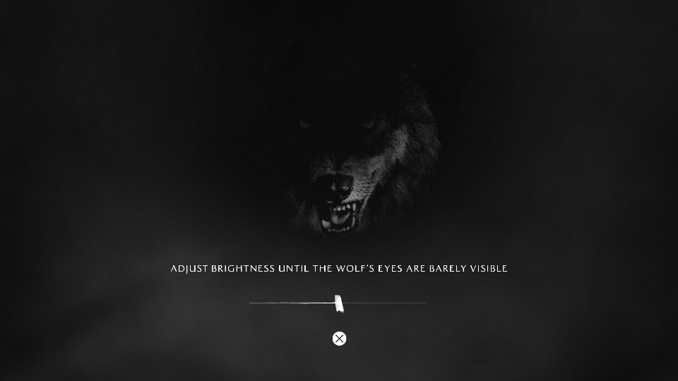
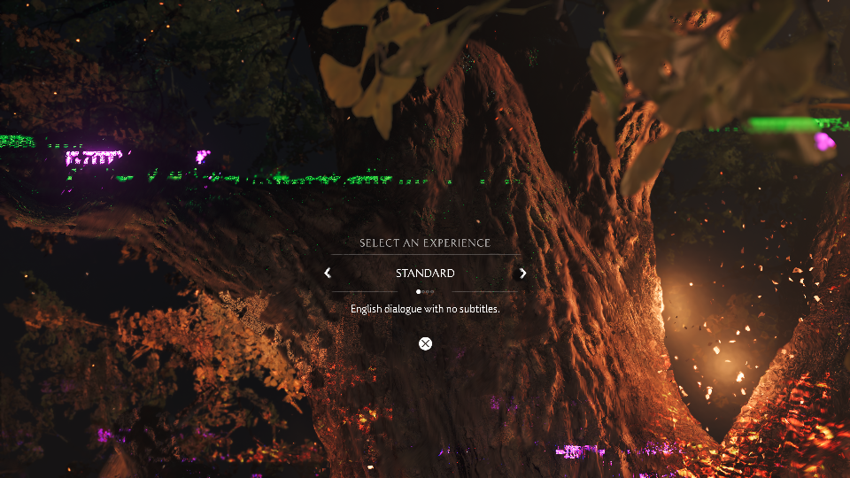

# Ghost of Yōtei on Linux AMD: Bring-up, Rendering Bugs, and Performance Work

An October 2026 investigation of **Ghost of Yōtei, PPSA26344, version 01.512.000**, running through AnyPS5's native relinker and Vulkan/RADV backend on an AMD Radeon RX 9060 XT.

**Historical integrated-stack status:** the final verification of that stack reached the setup screens and continued to frame 952, where it ended in OOM. Frames 880–951 presented at approximately **1.02 FPS**. Rendering defects remain; playable gameplay has not been verified.

A subsequent smoke test of current `main` plus the isolated pool correction built and started successfully but ended in OOM after about 122 seconds with a cold AnyPS5 cache. It did not establish a wolf/tree milestone or an FPS comparison. [Fresh-base result and limits](docs/EVIDENCE.md#current-main-native-smoke-test--october-17).

The intro was observed at nearly **20 FPS** before the slowdown toward the wolf. This is an approximate observation, separate from the measured tree-scene window.

## Screenshot milestones

These three captures come from the same run, `anyps5-yotei-20261017-083159-9b94aa`, and are shown in presentation order. Original screenshots are included without postprocessing.

### 1. Wolf calibration and Cross prompt — frame 840

### 2. Tree scene — frame 880

*The scene is reached, but visible color corruption remains.*

### 3. Setup selection — frame 920

*The screen reads “Select an Experience”, “Standard” and “English dialogue with no subtitles.”*

Other selected frames, including the earlier instrumented captures, remain in `assets/` and are identified in the [screenshot index](evidence/screenshots.csv).

### Frame-by-frame archive

An earlier documentation run saved **146 consecutive screenshots, frames 640–785**, before OOM. [Open the HTML gallery](capture-gallery.html) locally after downloading the report; GitHub serves the HTML source. [The frame/source mapping](evidence/capture-sequence.csv) covers every captured frame. This archive is a separate run from the three milestones above and is not used as a performance benchmark.

## Why share this work

The aim is to let another developer see what was actually tested, reuse small regressions, and continue from the current blockers. Negative results are included: several correct changes failed to improve frame rate and were reverted.

This work uses AnyPS5's relinker, library implementations and shader recompiler. It is not a new independent implementation of the project. The local EXEC workaround overlaps the already merged [PR #1264](https://github.com/boykopovar/AnyPS5/pull/1264); its regression results describe the older local stack, not a newly established current-main bug.

## Findings backed by evidence

| Area | Result | Scope |
|---|---|---|
| Vertex EXEC copy | A three-vertex draw copied `ffffffffffffffff` when its entry ballot was `0000000000000007`; the regression fails before the change and passes afterward | Real RADV GPU, 64-lane subgroup, draws of 3 and 64 vertices; sparse masks and ordinary SGPR `-1` values also checked |
| Descriptor setup, adapting PR #1334 | Median 28.311 → 3.953 µs/draw with one snapshot; 30.635 → 4.468 µs with eight | Focused microbenchmark; no meaningful wolf FPS improvement attributable to this change |
| Fewer written/atomic buffer copies | 0.785 → 0.966 FPS over the same frames 785–804; frame 800 is pixel-identical | One run pair; the experiment ended in OOM, so sustained performance is unproven |
| Shared formatted BDA lookup | GPU correctness passed, but the real hot shader's SPIR-V grew by 2.61% and the small four-component benchmark improved only about 2–3% | Candidate archived and disabled |

FPS is `1000 / median flip interval in milliseconds`. It measures presentation over a stated window, not monitor refresh rate. Logo, calibration and world-rendering windows must not be combined.

## Contents

- [Engineering notes and remaining blockers](docs/ENGINEERING-NOTES.md).
- [Published Linux discussion update](https://github.com/boykopovar/AnyPS5/discussions/2884#discussioncomment-18993375) ([local copy](docs/LINUX-DISCUSSION-DRAFT.md)).
- [Submitted current-main buffer-pool PR #7056](https://github.com/boykopovar/AnyPS5/pull/7056) ([submission text](docs/PR-DRAFT.md)), plus [other candidates and limitations](docs/UPSTREAM-CANDIDATES.md).
- [PRs used, local adaptations and attribution](docs/PR-INTEGRATION.md): 22 identified PR sources, plus the upstream EXEC equivalent, with verified authors and status.
- [Combined local source export and application notes](docs/LOCAL-INTEGRATION.md): the integrated AnyPS5 delta and SPIRV-Tools delta against their recorded bases.
- [Modified Mesa source patch and build instructions](docs/MESA-REPRODUCTION.md): the Mesa 26.2.3 ACO/NIR delta omitted from the original export.
- [Evidence and claim provenance](docs/EVIDENCE.md).
- `evidence/`: regression results, microbenchmark output and selected frame intervals.
- `patches/`: the combined local source export, SPIRV-Tools delta, and focused EXEC/descriptor excerpts. The historical exports use an older, modified base. The separate `small-device-buffer-retention.patch` is the focused current-main production contribution described above.

## Environment and reproducibility

Ryzen 7 5700X; RX 9060 XT 16 GB; 32 GiB RAM; Linux/Wayland; a locally modified Mesa 26.2.3 RADV build; Release configuration. Upstream starting revision: `832247b0a09c140c436d26a7f8333ff34f3df016`; the verified local stack has HEAD `d4fbcb3933a96704f00379f2507d9d72397c8881` plus uncommitted modifications.

Recent runs used a **12 GiB RAM / 2 GiB swap** cap with a 4 GiB desktop reserve and `ACO_NO_LDS_SPILL=1`. The latest verification also used `MALLOC_ARENA_MAX=2` and peaked at 12 GiB RAM plus 1808048128 bytes (about 1.68 GiB) of swap. This stack is not current stock `main` or unmodified Mesa. The exact historical kernel/distribution was not pinned in this selection; cross-machine reproduction is not claimed.

Screenshots and a warm cache do not reconstruct a source stack. The original workspace retains the implementation and launcher state; this selected handoff is not yet a complete reproducible distribution.

## Attribution and assistance

AnyPS5 and Mesa are the work of their respective contributors. Local work includes diagnosis, adaptations, tests and configuration, carried out with AI assistance. Adaptations are explicitly credited: in particular, [PR #1334](https://github.com/boykopovar/AnyPS5/pull/1334) is not an original optimization from this investigation.

The existing [Linux discussion #2884](https://github.com/boykopovar/AnyPS5/discussions/2884) is the destination for this progress update and handoff. The [general discussion #675](https://github.com/boykopovar/AnyPS5/discussions/675) records other contributors' platforms and results; those are not presented as local measurements.

Code derived from AnyPS5 is accompanied by its [GPL v2 license](LICENSE-AnyPS5). Game images remain the property of their rights holders and are not licensed as software here. No game executables, game archives, keys, saves, extracted shaders or pipeline caches are included.
